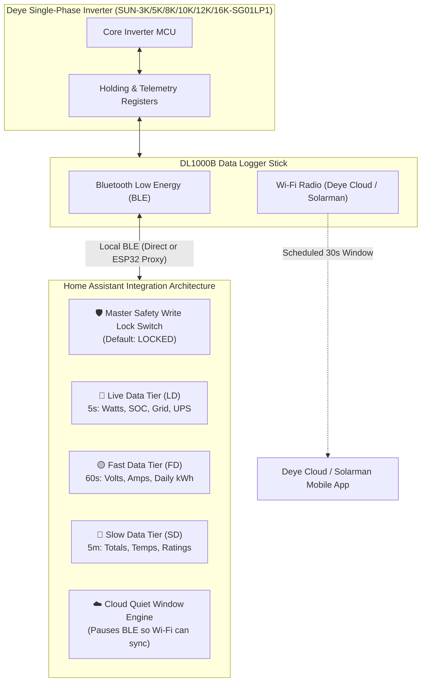

# Deye Single-Phase Inverter Bluetooth (Local BLE + Cloud Coexistence)

[](https://github.com/hacs/default)
[](https://www.home-assistant.io/)
[](https://github.com/abinanil123/deye-single-phase-ble)
[](https://opensource.org/licenses/MIT)

A high-performance Home Assistant custom integration for **Deye single-phase hybrid inverters** communicating locally and securely over **Bluetooth Low Energy (BLE)** via Home Assistant's onboard Bluetooth adapter or any standard ESP32 Bluetooth Proxy.

This project is tailored specifically for the single-phase Deye/Sunsynk LP1 platform, introducing a **Master Safety Write Lock**, **3-Tier Intelligent Polling (Live, Fast, and Slow data)**, a **Cloud Coexistence Engine** (preventing official Deye Cloud / Solarman app dropouts), and a **100% verified single-phase Modbus register map**.

---

## 🌟 Why This Integration Exists

| Feature | Standard Cloud / 3-Phase Integrations | This Integration (Deye Single-Phase BLE) |
| :--- | :---: | :---: |
| **Response Speed** | 5 to 15 minute cloud lag | **Sub-second to 5-second local BLE telemetry** |
| **Official App Status** | ❌ App disconnects / starves when BLE is kept open | ✅ **Full Cloud Coexistence** via scheduled quiet window |
| **Single-Phase Accuracy** | ❌ Reads 3-phase registers (`0x02xx`), zeroes, or wrong 5500W cap | ✅ **100% Verified Single-Phase LP1 Register Map** |
| **Write Protection** | ❌ Sliders immediately write to flash / EEPROM | 🛡️ **Master Safety Write Lock Toggle Switch** |
| **AUX / SmartLoad Port** | ❌ Ignored or bundled into generic house load | ✅ **Dedicated SmartLoad, Generator & UPS isolation** |
| **Local Independence** | ❌ Stops when internet goes down | ✅ **100% Local polling — works completely offline** |

---

## 🚀 Key Features & Highlights



---

### 1. 🛡️ Master Safety Write Lock Toggle Switch
To protect your inverter hardware and battery bank from accidental slider adjustments, accidental mobile touches, or unintended automations, this integration features a **Master Safety Write Lock switch**:

* **Entity:** `switch.deye_inverter_ble_allow_inverter_writes`
* **Default State:** **`OFF` (Locked / `mdi:lock`)**
* **How It Protects You:**
  * When **OFF**, all inverter holding register writes are strictly blocked. If you touch a slider or change an operating mode, Home Assistant displays a warning banner:  
    `"Inverter write blocked! Turn ON 'Allow Inverter Writes' safety switch before modifying settings."`  
    The control immediately snaps back to its safe inverter value.
  * When **ON**, writes are permitted and committed to the inverter using Modbus Function Code `0x10`.

---

### 2. ⚡ 3-Tier Intelligent Polling Engine
Instead of hammering the inverter's serial bus with hundreds of registers every second, this integration organizes telemetry into 3 distinct polling cycles:

* 🔴 **Live Data (BLE LD) — Fast & Responsive (Default: 5s, adjustable 1–10s):**
  * Instantaneous power telemetry: Solar Power, Battery Watts, Battery SOC %, Grid Import/Export Watts, Internal & External CT Watts, House Load, UPS Essential Load, and AUX SmartLoad Power.
* 🟡 **Fast Data (BLE FD) — Operational Telemetry (Default: 60s, adjustable 0–300s):**
  * PV1 & PV2 String Voltages/Currents, Grid Frequency, AC Voltage, Daily Solar (kWh), Daily Grid Import/Export (kWh), Daily Battery Charge/Discharge (kWh), Daily Load Consumption (kWh), DC & Inverter Heatsink Temperatures, and Grid Current L1.
* 🔵 **Slow Data (BLE SD) — Cumulative & Configuration (Default: 5 min, adjustable 5–100 min):**
  * Lifetime PV Generation (kWh), Lifetime Grid Import/Export (kWh), Lifetime Battery Charge/Discharge (kWh), Lifetime Total Consumption (kWh), Inverter Operating Status, and Hardware Ratings.

---

### 3. ☁️ Cloud Coexistence Engine (No More "Logger Offline")
The Deye logger stick (DL1000B) uses a single processor shared between Bluetooth and Wi-Fi. Permanent BLE connections monopolize the processor, starving the Wi-Fi module and knocking the official Deye Cloud / Solarman mobile app permanently offline.

Our **Cloud Coexistence Engine** allows you to choose your ideal operating mode via a single dropdown (`select.deye_inverter_ble_connection_mode`):

1. **`BLE with Deye Cloud` (Recommended):**
   * Home Assistant polls over BLE at high speed.
   * Every 5 minutes (user configurable), the integration cleanly pauses BLE for 30 seconds (`cloud_window_duration`), giving the logger dedicated time to upload to Deye Cloud. Both Home Assistant and your phone app stay 100% up to date!
2. **`BLE no Deye Cloud` (Pure Local):**
   * Disables the quiet window. Runs continuous, zero-gap BLE polling for users who do not use or want cloud connections.
3. **`No BLE (Only Deye Cloud)`:**
   * Shuts off local BLE polling and leaves the logger dedicated to cloud reporting.

---

### 4. 🎯 True Single-Phase LP1 Modbus Register Map
Upstream generic 3-phase integrations query three-phase addresses (`0x02xx`), which causes sensor timeouts, zeroes, or dangerous misconfigurations on single-phase hybrid units. This integration uses 100% verified single-phase addresses:

* **Max Sell Power:** Remapped to holding register **`0x00F5`** (solving the bug where Pete's 3-phase `0x008F` read telemetry and snapped back to ~5500W instead of 5000W).
* **Zero Export Power:** Remapped to single-phase holding register **`0x00CE`** (reads your exact trickle buffer, e.g. 20W).
* **Battery Chemistry Thresholds:** Single-phase registers **`0x00D9`** (Shutdown SOC), **`0x00DA`** (Restart SOC), and **`0x00DB`** (Low Battery Warning SOC).
* **Grid Charge Current Limit:** Configurable 0–185A charging rate at register **`0x00E6`**.
* **SmartLoad Dump Load Automations:** Registers **`0x00ED`** (Off SOC), **`0x00EF`** (On SOC), and **`0x00F1`** (Min Solar Power).
* **Grid Peak Shaving Limit:** Single-phase holding register **`0x0125`** and master flag bitmask **`0x0118`**.
* **Decoded Status Enums:** Operating Run State (`Normal`, `Standby`, `Self-Checking`, `Alarm`, `Fault`), Work Mode (`Sell to Grid`, `Zero Export to Load`, `Zero Export to CT`), and Energy Priority (`Battery First`, `Load First`).

---

## 🎛️ Unified Control Panel (Key Entities)

### Safety & Communication Controls
| Entity ID | Friendly Name | Description |
| :--- | :--- | :--- |
| `switch.deye_inverter_ble_allow_inverter_writes` | **Allow Inverter Writes** | 🛡️ Master Write Safety Lock (Default: OFF / Locked) |
| `select.deye_inverter_ble_connection_mode` | **BLE: Connection Mode** | Coexistence mode (`BLE with Deye Cloud`, `BLE no Deye Cloud`, `No BLE`) |
| `number.deye_inverter_ble_live_data_polling_interval_ble_ld` | **BLE: Live Polling Interval (LD)** | Live cycle interval in seconds (Default: `5s`) |
| `number.deye_inverter_ble_fast_data_polling_interval_ble_fd` | **BLE: Fast Polling Interval (FD)** | Fast cycle interval in seconds (Default: `60s`) |
| `number.deye_inverter_ble_slow_data_polling_interval_ble_sd` | **BLE: Slow Polling Interval (SD)** | Slow cycle interval in minutes (Default: `5 min`) |
| `number.deye_inverter_ble_cloud_sync_frequency` | **BLE: Cloud Sync Frequency** | Frequency of cloud quiet window (Default: `5 min`) |
| `number.deye_inverter_ble_cloud_window_duration` | **BLE: Cloud Window Duration** | Duration of quiet window in seconds (Default: `30s`) |

### Inverter Configuration Controls (Protected by Safety Switch)
| Entity ID | Type | Range / Options | Description |
| :--- | :---: | :---: | :--- |
| `number.deye_inverter_ble_max_sell_power` | Slider / Box | 0 – 8000 W | Inverter AC export cap |
| `number.deye_inverter_ble_zero_export_power` | Slider / Box | 0 – 500 W | Trickle grid import offset |
| `number.deye_inverter_ble_max_charge_current` | Slider / Box | 0 – 185 A | Global battery charging ceiling |
| `number.deye_inverter_ble_max_discharge_current`| Slider / Box | 0 – 185 A | Global battery discharge ceiling |
| `number.deye_inverter_ble_grid_charge_current_limit`| Slider / Box | 0 – 185 A | Max AC charge rate from utility grid |
| `number.deye_inverter_ble_battery_shutdown_soc` | Slider / Box | 0 – 100 % | Battery cutoff discharge threshold |
| `number.deye_inverter_ble_battery_restart_soc` | Slider / Box | 0 – 100 % | Battery reconnect threshold |
| `number.deye_inverter_ble_battery_low_soc` | Slider / Box | 0 – 100 % | Inverter audible low battery warning |
| `number.deye_inverter_ble_smartload_off_soc` | Slider / Box | 0 – 100 % | SmartLoad cutoff SOC |
| `number.deye_inverter_ble_smartload_on_soc` | Slider / Box | 0 – 100 % | SmartLoad activation SOC |
| `number.deye_inverter_ble_grid_peak_shaving_power_limit` | Slider / Box | 0 – 16000 W | Peak grid shaving ceiling |
| `select.deye_inverter_ble_work_mode` | Dropdown | Selling / Zero Export Load / Zero Export CT | Inverter export behavior |
| `select.deye_inverter_ble_energy_priority_pattern`| Dropdown | Battery First / Load First | Solar prioritization pattern |
| `select.deye_inverter_ble_io_port_mode` | Dropdown | SmartLoad / Generator / Microinverter | AUX/GEN port assignment |
| `switch.deye_inverter_ble_solar_sell` | Switch | ON / OFF | Solar export toggle |
| `switch.deye_inverter_ble_grid_charge_master` | Switch | ON / OFF | Utility grid charging toggle |
| `switch.deye_inverter_ble_time_of_use` | Switch | ON / OFF | Time-of-Use 6-slot schedule toggle |

---

## 📦 Installation

### Method 1: Via HACS (Recommended)
1. Open **HACS** in your Home Assistant sidebar.
2. Click the three dots `⋮` in the top right corner and select **Custom repositories**.
3. Paste this repository URL:
   ```text
   https://github.com/abinanil123/deye-single-phase-ble
   ```
4. Set Type to **Integration** and click **Add**.
5. Find **Deye Single-Phase Inverter Bluetooth** and click **Download**.
6. Restart Home Assistant.
7. In Home Assistant, navigate to **Settings > Devices & Services > Add Integration**, search for **Deye Bluetooth (Local)**, and follow the discovery/configuration steps!

### Method 2: Manual Installation
1. Download the `custom_components/deye_ble/` directory from this repository.
2. Copy the `deye_ble` folder into your Home Assistant `<config>/custom_components/` directory.
3. Restart Home Assistant.
4. Add the integration via **Settings > Devices & Services**.

---

## 📡 Using ESP32 Bluetooth Proxy (Optional)
If your Home Assistant server is located far from your inverter, you can use any inexpensive ESP32 board running ESPHome as an active Bluetooth proxy. Add this to your ESPHome configuration:

```yaml
esp32_ble_tracker:
  scan_parameters:
    interval: 1100ms
    window: 1100ms
    active: true

bluetooth_proxy:
  active: true
```

Home Assistant will automatically connect to your Deye inverter through the ESP32 proxy with zero extra configuration!

---

## 🤝 Community & Attribution
* Built upon the pioneering protocol research by **@PetePeter** ([PetePeter/deye-bluetooth](https://github.com/PetePeter/deye-bluetooth)).
* Register maps verified and cross-referenced with official Deye Modbus specifications (V118/V120), **@davidrapan** (ha-solarman), and the Sunsynk open-source solar community.

---

## 📄 License
This project is open-source under the **MIT License**. Contributions, bug reports, and pull requests are warmly welcomed!
